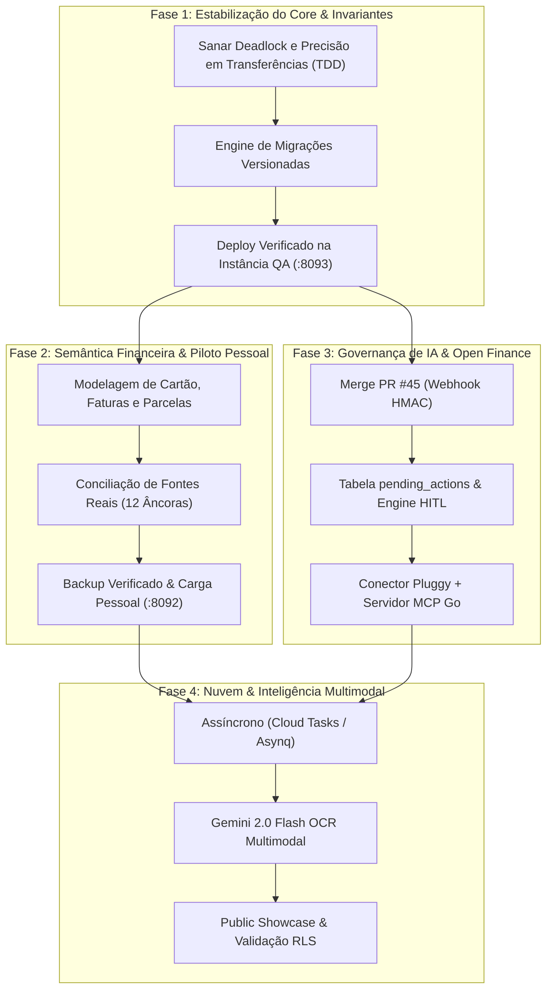

# Planejamento Técnico e Operacional Consolidado — IntelliFinance Go

- **Data de Consolidação**: 11 de Novembro de 2026
- **Status**: Proposta Unificada para Revisão e Aprovação (Nenhuma issue remota foi alterada ainda)
- **Localização**: `docs/CONSOLIDATED_MASTER_PLAN.md`
- **Ambiente de Referência**: Host `lm-claw` (Ubuntu 26.10, Go 1.25, PostgreSQL 16, Chi v5, React 19 SPA)
- **Branch Ativa**: `work/local-development` (commit base local `b35f227` sobre `origin/dev`)

---

## 1. Visão Executiva e Fontes Analisadas

Este documento unifica e reconcilia integralmente quatro fontes primárias de informação, eliminando divergências entre o planejamento conceitual de longo prazo e o estado real implementado no host:

1. **Planos do Agente Hermes (`~/.hermes/plans/`)**:
   - `2026-11-06_205939-intellifinance.md`: Diretrizes de organização segura, separação de worktrees, reconciliação de issues sem quebra de gates e preservação estrita de dados privados/sessões.
   - `intellifinance-go-pluggy-mcp.md`: Arquitetura completa da integração Pluggy Open Finance + Servidor MCP nativo em Go, com modelo estrito de governança HITL (*Human-In-The-Loop*) via tabela `pending_actions`, snapshot de saldos separado de movimentos de ledger, tratamento de PIX e faturas de cartão.
2. **Controle de Estado do Piloto Pessoal (`~/.local/state/intellifinance/personal-rollout/`)**:
   - `checkpoint.md`, `report.md`, `mapping-review.md`, scripts de validação (`decimal_anchors.py`, `inspect_sources.py`): Registro detalhado da infraestrutura criada no host `lm-claw` (PostgreSQL em portas dedicadas 55433 e 55434, serviços systemd `intellifinance-personal` e `intellifinance-personal-qa`, autenticação fail-closed Basic/bcrypt, prova de restauração de banco vazio e importador canônico `cmd/import-ledger`).
   - Inventário detalhado de 135 arquivos CSV de histórico financeiro real, 12 âncoras bancárias validadas em Decimal e lacunas abertas de semântica (cartões, transferências internas entre contas próprias, parcelamentos e dívidas).
3. **Repositório Local e Documentação Interna (`workspace/intellifinance-go/docs/`)**:
   - `ROADMAP.md` e `PRD.md`: Visão arquitetural de Fases 0 a 5 (Homelab $0 baseline vs GCP Serverless).
   - `DEVELOPMENT_STATUS.md`, `PERSONAL_PILOT_PLAN.md` e `PERSONAL_PILOT_OPERATIONS.md`: Relato minucioso dos testes, gates (`make test` com 264-392 eventos Go, `-race`, zero skips), e dois bloqueadores técnicos estáticos identificados na fatia de transferências internas.
4. **Estado Remoto e Backlog do GitHub (`luismarquitti/intellifinance-go`)**:
   - 32 issues registradas: 15 fechadas (Fase 0, modelagem DDL, persistência inicial, parsers, seeder e MVP Dashboard #40 a #44) e 17 abertas (#13 a #27, #35 e #36).
   - Pull Request aberto: PR #45 (`feat/gh-14`) aguardando merge para o webhook de Open Finance.

---

## 2. Diagnóstico do Estado Atual vs. Lacunas Críticas

### 2.1 O que já está Comprovado e Entregue
- **Arquitetura & Base**: Arquitetura Hexagonal estruturada em Go 1.25, PostgreSQL 16 com RLS por tenant (`app.current_tenant_id`), `sqlc` v2 e `pgx/v5`.
- **MVP Dashboard Local**: Frontend React 19 + Tailwind embutido via `embed.FS` no binário compilado.
- **Isolamento de Ambientes no Host**:
  - `dev` (:8090, PG :55432) — Ambiente volátil para desenvolvimento com dados sintéticos e bypass.
  - `personal` (:8092, PG :55433) — Loopback protegido por HTTP Basic + bcrypt, sem bypass dev, sem seed e sem auto-migrate.
  - `qa` (:8093, PG :55434) — Ambiente isolado para validação de ingestão e testes destrutivos.
  - 4 unidades systemd ativas e habilitadas em linger.
- **Importador Canônico Rastreável (`cmd/import-ledger`)**:
  - Ingestão atômica de CSV canônico com preservação da linha física e hashes SHA-256.
  - Proveniência imutável e idempotência estrita via sequence index e advisory locks.
  - Não duplica saldos em reexecuções.

### 2.2 Bloqueadores Técnicos e Lacunas em Aberto
1. **Fatia de Transferências Internas (Bloqueador Estático)**:
   - *Bloqueador 1 (Precisão Decimal)*: Aceita frações inferiores a R$ 0,01 que sofrem truncamento pelo `NUMERIC(15,2)`, gerando assimetria entre as duas pernas.
   - *Bloqueador 2 (Risco de Deadlock)*: Concorrência entre validação de moeda (`FOR SHARE`) e triggers de saldo (`trg_sync_balance`) pode travar conexões sob alta concorrência de pares distintos.
   - *Status*: Candidato presente em código não commitado no checkout, bloqueado para deploy até correção via TDD (RED/GREEN).
2. **Ausência de Migrador Versionado**:
   - O startup atual do `cmd/api` verifica apenas a existência da tabela `tenants`. Não há sistema de migrações versionadas (ex.: tabela de controle `schema_migrations`, lock de migração e suporte a upgrades atômicos incrementais).
3. **Semântica Financeira de Fontes Reais**:
   - Falta suporte a faturas de cartão de crédito (separar compra, fatura, parcelas e pagamento para evitar contagem dupla de despesas).
   - Classificação e conciliação de transferências entre contas próprias antes de qualquer carga pessoal no banco `:55433`.
4. **Governança de IA & Automação (MCP + Pluggy)**:
   - Integração Open Finance não deve ter permissão direta de mutação financeira sem consentimento explícito. Exigência do fluxo HITL via `pending_actions`.

---

## 3. Matriz de Reconciliação do Backlog & GitHub Issues

A auditoria cruzada identificou a necessidade de reestruturação do backlog do GitHub para refletir a realidade do projeto:

| Issue / PR | Título / Escopo | Estado Atual | Diagnóstico & Ação Proposta |
|---|---|---|---|
| **PR #45** | `feat(gh-14)`: Endpoint de Webhook Open Finance | Aberto | **Auditar e Mesclar**: Contém resolução de tenant por item e HMAC constant-time. Rebase/merge em `dev` fecha a Issue #14. |
| **#14** | [Phase 2] Endpoint de Webhooks Open Finance | Aberto | **Fechar** após validação e merge do PR #45. |
| **#35** | [Execução Local] Bootstrap de execução local ponta a ponta | Aberto | **Atualizar e Fechar**: O bootstrap local já foi entregue via commit `b35f227` e scripts `local-dev.sh`. Resta formalizar o fechamento. |
| **#36** | [Frontend] Definição e desenvolvimento do frontend | Aberto | **Atualizar e Fechar**: SPA React 19 já foi entregue em #43 e embutida no binário. |
| **#13** | [Phase 2] Conector Open Finance Pluggy (Sandbox/Live) | Aberto | **Reestruturar**: Transformar no módulo `Pluggy + MCP Native Go`, incorporando o plano `intellifinance-go-pluggy-mcp.md`. |
| **#15** | [Phase 2] Worker Assíncrono com Redis/Asynq | Aberto | **Repriorizar**: O modelo homelab/pessoal priorizou execução local desacoplada sem dependência forçada de Redis para o MVP. Manter no roadmap de escala. |
| **#16** | [Phase 2] Motor de Co-Orçamento Familiar | Aberto | **Manter Aberto**: Próxima etapa de regras de divisão (50/50, proporcional). |
| **#17-#20** | [Phase 3] Containerização Distroless, GCP Serverless | Abertas | **Manter no Backlog**: Fases futuras (Cloud Run, Cloud Tasks, Secret Manager). |
| **#21-#24** | [Phase 4] Vertex AI, Gemini 2.0 Flash, OCR Multimodal | Abertas | **Manter no Backlog**: Integração com `google.golang.org/genai` e LiteLLM offline. |
| **#25-#27** | [Phase 5] Documentação, RLS Validation, Showcase | Abertas | **Manter no Backlog**: Fase de polimento público e auditoria LGPD. |
| **NOVA** | Migrações Versionadas Explícitas & Engine DDL | *A Criar* | Substituir auto-migrate rudimentar por migrador atômico e lock antes de novos esquemas. |
| **NOVA** | Correção de Invariantes de Transferências Internas | *A Criar* | Sanar bloqueadores de precisão de centavos e ordenação de locks anti-deadlock. |
| **NOVA** | Engine HITL (`pending_actions`) & Servidor MCP Go | *A Criar* | Criar suporte a ferramentas MCP de leitura e proposta assíncrona aprovada por humanos. |
| **NOVA** | Cartão de Crédito, Faturas e Conciliação de Dívidas | *A Criar* | Modelagem de faturas, parcelamentos e prevenção de dupla contagem de pagamentos. |

---

## 4. Roteiro de Execução em Fases Sequenciais

### Etapa 1: Estabilização do Core e Invariantes Locais (Imediato)
1. **Desbloqueio de Transferências Internas**:
   - Implementar testes RED/GREEN para rejeição estrita de frações de centavos (`amount.Truncate(2) == amount`).
   - Padronizar aquisição de locks nas pernas de transação para evitar deadlocks (`ORDER BY account_id ASC`).
   - Aplicar correções, rodar `make test` (-race) e `make lint`.
2. **Migrador Versionado Dedicado**:
   - Criar `cmd/migrate` ou migrador em bootstrap com tabela de versionamento e locks transacionais.
3. **Validação na Instância QA**:
   - Compilar binário, aplicar na instância QA (:8093) e executar smoke tests de API e navegador.

### Etapa 2: Semântica Financeira e Desbloqueio do Piloto Pessoal
1. **Cartão de Crédito & Faturas**:
   - Estruturar modelo para faturas e despesas de cartão sem duplicar liquidação com a conta corrente de débito.
2. **Reconciliação das 12 Âncoras Bancárias**:
   - Validar mapeamento dos 135 CSVs do inventário privado com o validador decimal.
3. **Carga Pessoal Segura**:
   - Gerar dump pré-carga, restaurar em banco de teste descartável para homologar restauração.
   - Executar carga real via `cmd/import-ledger --apply` na base pessoal (:55433).
   - Validar persistência e reiniciar serviços com dados reais.

### Etapa 3: Open Finance & Servidor MCP com Governança HITL
1. **Webhook Open Finance**:
   - Revisar, rebasear e fazer merge do PR #45.
2. **Motor de Ações Pendentes (HITL)**:
   - Migration e repositório para `pending_actions` (`PENDING → APPROVED → EXECUTED`).
3. **Servidor MCP Nativo Go (`cmd/mcp`)**:
   - Implementar ferramentas de leitura (`list_accounts`, `get_balances`, `list_transactions`, `summarize_transactions`).
   - Implementar ferramentas de proposta assíncrona (`request_categorization`, `request_sync`).
   - Bloquear expressamente ferramentas de mutação direta ou aprovação automática por IA.
4. **Adaptador Pluggy**:
   - Implementar cliente HTTP resiliente com cache de token, rate-limiting e sync mapeado.

### Etapa 4: Fases Avançadas (Cloud & IA Multimodal)
1. Conectar worker assíncrono para processamento em segundo plano.
2. Integrar Gemini 2.0 Flash (`google.golang.org/genai`) para OCR de comprovantes e categorização contextual com fallback local.
3. Concluir validação de segurança RLS multi-tenant para showcase público no GitHub.

---

## 5. Próximos Passos & Solicitação de Aprovação

Para prosseguir, peço sua revisão e aprovação deste plano mestre unificado:

1. **Aprovação do Plano**: Confirmação de que as prioridades e a sequência (1. Estabilização de Transferências → 2. Migrador & Piloto Pessoal → 3. Pluggy + MCP Go HITL → 4. Cloud & IA) atendem às suas expectativas.
2. **Ações no GitHub (Após Aprovação)**:
   - Fechar issues já concluídas no código (#35, #36).
   - Realizar merge do PR #45 e fechar a Issue #14.
   - Atualizar a Issue #13 para contemplar a especificação completa Pluggy + MCP.
   - Criar as issues pontuais de sustentação (Migrações Versionadas, Invariantes de Transferência, HITL Engine).
