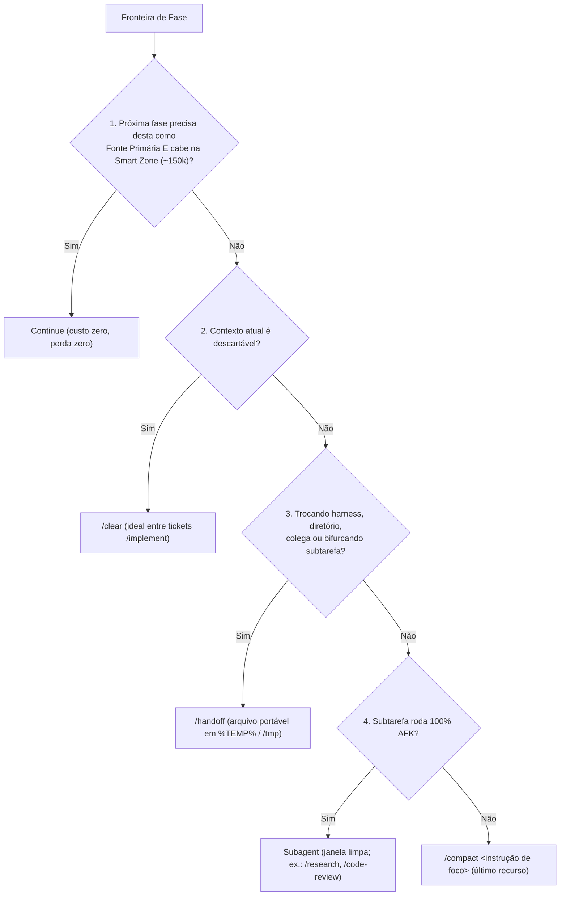
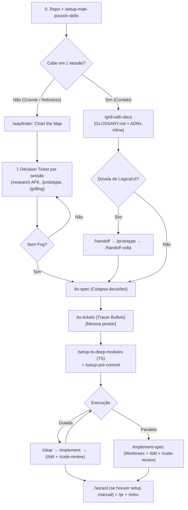
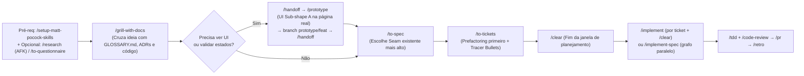
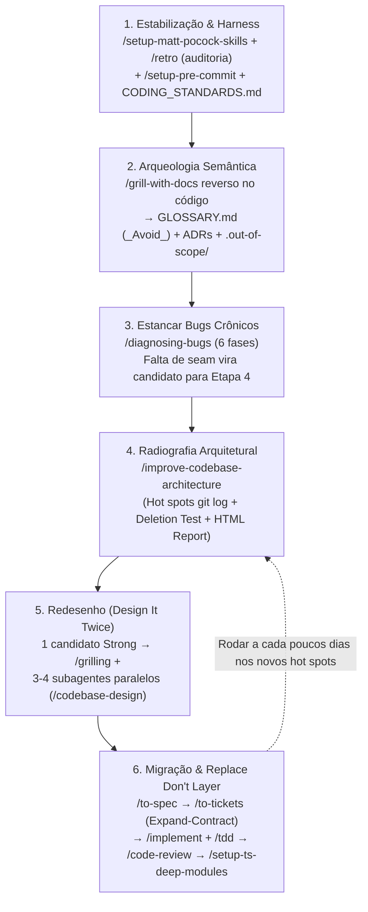

# Guia Prático, Conceitos e Workflows: `mattpocock/skills`

> [!NOTE]
> Este guia consolida a arquitetura, os conceitos teóricos e os fluxos práticos baseados na inspeção integral do repositório [`mattpocock/skills`](https://github.com/mattpocock/skills/tree/5863806dd4e15c63174bee4e7515a4256792ecfa) (commit `5863806`). Uma cópia curada no padrão OKF 0.2 foi persistida no seu PKM em [guia-pratico-skills-matt-pocock.md](file:///C:/Users/Luis%20Marquitti/.gemini/antigravity/worktrees/personal-knowledge/matt_pocock_skills_guide/areas/engenharia-ia/guia-pratico-skills-matt-pocock.md).

---

## 1. A Filosofia: "Skills For Real Engineers"

Matt Pocock construiu esse repositório como antídoto contra dois extremos: o **vibe coding** sem disciplina e os **frameworks pesados de processo** (como GSD, BMAD ou Spec-Kit) que sequestram o fluxo de engenharia e tornam falhas difíceis de depurar.

Em vez de um pipeline monolítico, o repositório aplica o princípio **Unix** aos agentes de código: **skills pequenas, editáveis, agnósticas de modelo e componíveis**. Cada skill resolve um dos **4 modos de falha clássicos**:

| Modo de Falha | Base Teórica | Antídoto no Repositório |
| :--- | :--- | :--- |
| **1. Desalinhamento** (*"O agente não fez o que eu queria"*) | *The Pragmatic Programmer* ("Ninguém sabe exatamente o que quer") | **Grilling Sessions** (`/grill-me`, `/grill-with-docs`, `/grilling`): o agente entrevista você em rodadas pela fronteira da árvore de decisão antes de escrever código. |
| **2. Verbosidade e Deriva Semântica** (*"O agente gasta 20 palavras onde 1 bastaria"*) | *Domain-Driven Design* (Eric Evans — *Ubiquitous Language*) | **Modelagem de Domínio Inline** (`/domain-modeling` + `GLOSSARY.md` com lista `_Avoid_` + `docs/adr/`): cria vocabulário compartilhado que reduz tokens de raciocínio e estabiliza nomes no código. |
| **3. Código Quebrado** (*"As entregas não funcionam"*) | *The Pragmatic Programmer* ("A taxa de feedback é seu limite de velocidade") | **Loops de Feedback Apertados** (`/tdd` + `/diagnosing-bugs`): ciclo Red → Green em costuras públicas acordadas e proibição absoluta de teorizar bugs sem um comando vermelho determinístico. |
| **4. Bola de Lama Acelerada** (*"Entropia em alta velocidade"*) | *Extreme Programming* (Kent Beck) + *A Philosophy of Software Design* (John Ousterhout) | **Módulos Profundos** (`/codebase-design` + `/improve-codebase-architecture` + `/to-spec`): concentrar complexidade atrás de interfaces pequenas e costuras (*seams*) limpas. |

---

## 2. Como as Skills Funcionam por Baixo dos Panos

### 2.1 `User-invoked` vs. `Model-invoked`
O repositório divide suas skills por **quem pode invocá-las** (verificado em `.agents/invocation.md`):

- **`User-invoked` (Orquestradoras)**: possuem `disable-model-invocation: true` (Claude Code) e `policy.allow_implicit_invocation: false` (Codex). **Só disparam quando você digita `/<nome>`**.
  - **Custo**: zero *context load* (a descrição não fica carregada na janela do agente), mas exigem *cognitive load* do humano (aliviado pelo roteador `/ask-matt`).
  - **Invariante**: uma skill `user-invoked` pode chamar skills `model-invoked`, mas **nunca** outra `user-invoked`.
- **`Model-invoked` (Disciplinares / Vocabulário)**: sua `description` fica carregada como *context pointer* com gatilhos semânticos para que o agente (ou outras skills via `Skill` tool) a dispare autonomamente.

### 2.2 Engenharia de Contexto (`/writing-for-agents`)
1. **Hierarquia de 3 níveis**: (1) *In-file step* (passos em ordem); (2) *In-file reference* (regras planas sob demanda); (3) *Disclosed reference* (arquivos irmãos como `DEEPENING.md`, `LOGIC.md`, `UI.md`, `AGENT-BRIEF.md`, carregados só quando o ramo exigir).
2. **Leading Words**: palavras densas já ancoradas no pré-treinamento do modelo (*seam*, *deep module*, *tracer bullet*, *fog of war*, *tight*, *red*, *relentless*) ativam comportamentos complexos com pouquíssimos tokens.
3. **Prompting Positivo**: evita proibições ("não faça X", que ativam o conceito proibido na atenção) e define critérios de conclusão binários (*Clarity* + *Demand*) para impedir **conclusão prematura** (*premature completion*).

### 2.3 Higiene de Contexto e a Árvore de `PHASE-BOUNDARIES.md`

Modelos raciocinam no auge dentro da **Smart Zone** (~150k tokens). Nas transições entre fases (ex.: fim do *grilling*, fim da *spec*, fim de um *ticket*), aplica-se a árvore de 5 perguntas em ordem estrita (**o primeiro "Sim" vence**):



> [!TIP]
> **Regra de ouro**: Mantenha `/grill-with-docs` → `/to-spec` → `/to-tickets` na **mesma janela contínua (`Continue`)**. Só dê `/clear` depois que os tickets estiverem gerados, rodando `/implement` com contexto fresco para cada ticket. Execute `/retro` **antes** do `/clear` (ou apontando para o log da sessão).

---

## 3. Catálogo Conceitual Completo

### 3.1 Engenharia — `User-invoked` (11 Skills)
| Skill | Conceito Central & Comportamento | Artefatos |
| :--- | :--- | :--- |
| **`/ask-matt`** | Roteador mestre sobre o fluxo principal (*idea → ship*), *on-ramps* e fronteiras de fase. | Mapa vivo no chat |
| **`/setup-matt-pocock-skills`** | Setup único por repositório (pré-requisito das demais skills de engenharia). | `docs/agents/{issue-tracker,domain,triage-labels}.md` + bloco em `CLAUDE.md`/`AGENTS.md` |
| **`/grill-with-docs`** | Compõe `/grilling` + `/domain-modeling` dentro de um repositório. | `GLOSSARY.md` / `GLOSSARY-MAP.md` + `docs/adr/NNNN-*.md` |
| **`/wayfinder`** | Planejamento de esforços gigantes (>1 sessão). Regra: **"Plan, don't do"**; gerencia o **Fog of War** (*Not yet specified*) e resolve 1 ticket HITL por sessão. | Issue `wayfinder:map` + *Decision Tickets* (`research`, `prototype`, `grilling`, `task`) |
| **`/to-spec`** | Sintetiza o que já foi discutido (**sem reentrevistar**) e alinha as costuras de teste (*seams*) no ponto mais alto possível (ideal = 1). | Spec no tracker (`ready-for-agent`) sem caminhos de arquivo perecíveis |
| **`/to-tickets`** | Quebra planos/specs em **Tracer Bullets** verticais (cortam DB → API → UI → teste, cabem em 1 janela) com grafo de bloqueio. *Wide Refactors* usam **Expand → Migrate → Contract**. | Arquivos em `.scratch/<feature>/issues/<NN>-<slug>.md` ou issues com *blocking edges* nativas |
| **`/implement`** | Implementa um ticket ou spec pequena usando `/tdd` nas costuras acordadas e fechando com `/code-review` antes do commit. | Código + testes + commit |
| **`/implement-spec`** | Orquestra toda uma spec em uma *integration branch* via **task graph**, disparando *implementer subagents* paralelos na fronteira pronta em *git worktrees* isoladas + *merger subagent* + `/code-review`. | Integration branch + PR final |
| **`/improve-codebase-architecture`** | Varre a base (YAGNI + `git log --oneline`) buscando oportunidades de aprofundamento, aplica o **Teste da Deleção** e conduz *grilling* do candidato escolhido. | `<tmpdir>/architecture-review-<timestamp>.html` (Tailwind + Mermaid/SVG Antes vs. Depois) |
| **`/triage`** | Máquina de estados (`needs-triage`, `needs-info`, `ready-for-agent`, `ready-for-human`, `wontfix`) para issues e PRs externos (não usar em tickets de `/to-tickets`). | Comentários com *Agent Brief* durável (`AGENT-BRIEF.md`) e `.out-of-scope/*.md` |
| **`/retro`** | Retrospectiva focada no **ambiente do agente** (não no código), em 7 eixos: *Navigation*, *Automated checks*, *Coding standards*, *Global AGENTS.md*, *Tool economy*, *No-ops* e *Information access*. | Regras em linters/CI, `CODING_STANDARDS.md`, ponteiros de navegação |

### 3.2 Engenharia — `Model-invoked` (9 Skills)
| Skill | Conceito Central & Comportamento | Artefatos / Referências |
| :--- | :--- | :--- |
| **`/domain-modeling`** | Desafia termos vagos contra `GLOSSARY.md`, testa edge cases e cruza contra o código real. Cria ADRs apenas sob o **Critério Tríplice** (difícil de reverter + surpreendente sem contexto + trade-off real). | `GLOSSARY.md`, `GLOSSARY-MAP.md`, `docs/adr/` |
| **`/codebase-design`** | Vocabulário rígido (**Module, Interface, Implementation, Depth, Seam, Adapter, Leverage, Locality**). Traz `DEEPENING.md` (4 categorias de dependência + **"Replace, don't layer"**) e `DESIGN-IT-TWICE.md` (3–4 subagentes paralelos). | Design de interfaces profundas |
| **`/tdd`** | Loop **Red → Green** uma fatia vertical por vez em costuras públicas pré-acordadas. Proíbe mocks internos (`mocking.md`), testes tautológicos e *horizontal slicing*. Refactor fica para o `/code-review`. | Testes comportamentais na interface |
| **`/code-review`** | Dois subagentes paralelos com janelas limpas sobre `git diff <fixed-point>...HEAD`: **Eixo Standards** (`CODING_STANDARDS.md` + 12 Code Smells de Fowler) e **Eixo Spec** (lacunas, *scope creep*, bugs lógicos). | Relatório duplo não-mesclado |
| **`/diagnosing-bugs`** | Loop científico de 6 fases: (1) construir *tight loop* vermelho determinístico (10 formatos possíveis); (2) reproduzir e minimizar até restar só o *load-bearing*; (3) 3–5 hipóteses falsificáveis; (4) instrumentar 1 variável por vez (`[DEBUG-xxxx]`); (5) teste na costura certa; (6) cleanup. | Repro + teste de regressão (ou alerta de falta de costura) |
| **`/prototype`** | Código descartável para responder 1 pergunta: **`LOGIC.md`** (HTML autocontido clicável para não-devs) ou **`UI.md`** (3–5 variantes estruturais na mesma rota via `?variant=`, preferindo **Sub-shape A** na página real). | Branch `prototype/<nome>` (fonte primária preservada fora da `main`) |
| **`/research`** | Subagente em background com janela limpa investigando **fontes primárias** (docs oficiais, código-fonte, specs). | Markdown citado no repositório |
| **`/pr`** | Corpo de PR direto ao ponto: **Summary** (menor visual: pseudocódigo, árvores, Mermaid ou diff), **Evidence** (Antes/Depois) e **Merge Danger** (*One-way/Two-way door* + *Blast Radius*). | Descrição do Pull Request |
| **`/wizard`** | Gera script bash interativo (`template.sh`) para etapas exclusivamente humanas (clicar em dashboards, criar chaves, salvar `.env` e `gh secret`). | Script bash executável |

### 3.3 Produtividade (7 Skills) e `In-Progress` / `Misc`
- **Produtividade (`User-invoked`)**: `/grill-me` (entrevista *stateless* sem repo), `/handoff` (doc portável em `%TEMP%`/`/tmp`), `/to-questionnaire` (questionário para terceiros focado no *send* e na lacuna de conhecimento), `/wait-what` (re-explica em *Simplified Technical English* + `GLOSSARY.md`), `/teach` (workspace multi-sessão de estudo com *storage strength*).
- **Produtividade (`Model-invoked`)**: `/grilling` (motor de entrevista por rodadas na fronteira), `/writing-for-agents` (regras de design de contexto e skills).
- **`In-Progress` (Beta)**: **`/setup-ts-deep-modules`** (configura `dependency-cruiser` com 4 regras estritas e testa se as regras falham em *deep imports*), `/loop-me`, `/software-factory` (*"accelerators without brakes make a slop cannon"*), `/chief-of-staff`, `/claude-handoff`, `/writing-beats`, `/writing-fragments`, `/writing-shape`.
- **`Misc` (Congelado)**: `/git-guardrails-claude-code`, `/setup-pre-commit`, `/migrate-to-shoehorn`, `/scaffold-exercises`.

---

## 4. Instalação Rápida e Setup por Projeto

```bash
# Claude Code
claude plugin install mattpocock-skills@claude-plugins-official

# Codex
codex plugin marketplace add mattpocock/skills
codex plugin add mattpocock-skills@mattpocock

# Gemini CLI
gemini skills install https://github.com/mattpocock/skills.git --path skills/engineering
gemini skills install https://github.com/mattpocock/skills.git --path skills/productivity

# Cursor, OpenCode, Windsurf, Devin, etc. (cópia editável)
npx skills@latest add mattpocock/skills -a <agent>

# Skill Beta específica (ex.: blindagem TypeScript)
npx skills@latest add mattpocock/skills --skill=setup-ts-deep-modules
```

Em todo repositório novo, rode **`/setup-matt-pocock-skills`** primeiro:
- Para projetos colaborativos ou com remoto ativo: escolha **GitHub** (ou GitLab).
- Para experimentos solo ou saneamento privado sem sujar o GitHub: escolha **Local markdown** (`.scratch/<feature>/issues/`).

---

## 5. Os 3 Workflows Repetíveis

### Workflow 1: Novo Projeto do Zero a partir de uma Ideia Inicial (*Greenfield*)



**Checklist de Execução Repetível (Greenfield):**
1. **Fundação**: `git init` + `/setup-matt-pocock-skills`.
2. **Descoberta de Escopo**:
   - Ideia contida: rode **`/grill-with-docs`** e responda às rodadas até esgotar a árvore (gerando `GLOSSARY.md` e os primeiros `docs/adr/`).
   - Sistema grande/nebuloso: rode **`/wayfinder`** para criar o `wayfinder:map`, deixe os subagentes de `/research` rodarem em paralelo e resolva **1 ticket HITL por sessão** até limpar `Not yet specified`.
3. **Prototipação de Incertezas (se houver)**: **`/handoff`** → **`/prototype`** (`LOGIC.md` para máquina de estados ou `UI.md` para 3 layouts) → salve na branch `prototype/<nome>` → **`/handoff`** de volta.
4. **Síntese & Fatiamento (sem dar `/clear`)**: rode **`/to-spec`** (valide a costura mais alta proposta) e imediatamente **`/to-tickets`** (aprove fatias verticais demonstráveis e dependências).
5. **Blindagem Estrutural**: configure linter/typecheck/test runner e, se TypeScript, rode **`/setup-ts-deep-modules`**.
6. **Construção**: dê **`/clear`** e execute ticket a ticket com **`/implement`** (limpando contexto entre tickets) ou dispare **`/implement-spec`** em paralelo.
7. **Entrega e Aprendizado**: use **`/wizard`** para chaves/infra humanas, **`/pr`** no Pull Request e **`/retro`** antes de encerrar a sessão.

---

### Workflow 2: Nova Feature / Funcionalidade em Projeto Existente (*Brownfield*)



**Checklist de Execução Repetível (Brownfield):**
1. **Insumos Assíncronos (se necessário)**: dispare **`/research`** em background para APIs/docs externos ou **`/to-questionnaire`** para destravar regras de negócio com stakeholders.
2. **Alinhamento contra o Código Real (`/grill-with-docs`)**: o agente lê `GLOSSARY.md` e `docs/adr/`, confronta sua proposta com o comportamento atual do código e atualiza glossário/ADRs inline.
3. **Desvio Seguro de Prototipação (opcional)**: se precisar comparar interfaces na tela real do app, faça **`/handoff`** → **`/prototype`** (**Sub-shape A**, montando `?variant=A|B|C` dentro da rota e dados reais existentes) → salve em `prototype/<nome>` → volte à thread de planejamento.
4. **Spec na Mesma Janela (`/to-spec`)**: **sem dar `/clear`**, sintetize a conversa e confira no Passo 2 se a costura de teste proposta reutiliza uma costura pública existente no ponto mais alto possível.
5. **Fatiamento com *Prefactoring* (`/to-tickets`)**: ainda na mesma janela, garanta que qualquer preparação arquitetural necessária venha como Ticket 01 (*"Make the change easy, then make the easy change"*), seguida de fatias verticais independentes.
6. **Execução Limpa**: dê **`/clear`** e rode **`/implement <ticket>`** (um ticket por janela limpa) ou **`/implement-spec <spec>`** (subagentes em worktrees).
7. **Fechamento**: abra o PR formatado por **`/pr`** e execute **`/retro`** para transformar qualquer tropeço do agente em regra de linter ou linha em `CODING_STANDARDS.md`.

---

### Workflow 3: Análise, Simplificação e Refatoração de Projeto "Vibe-Coded"

Projetos criados no modo *vibe-code* sofrem de **rasidão estrutural** (muitos wrappers *pass-through*), **deriva semântica** (múltiplos nomes para o mesmo conceito), **baixa localidade** (1 regra espalhada em vários arquivos) e **testes frágeis ou ausentes**.



**Playbook em 6 Etapas Repetíveis (Vibe-Code Rescue):**
1. **Etapa 1 — Rede de Proteção e Limpeza de Contexto**:
   - Rode **`/setup-matt-pocock-skills`** (use tracker **Local markdown** em `.scratch/` se não quiser expor o saneamento no tracker público).
   - Rode **`/retro`** como auditoria do estado atual: enxugue `AGENTS.md`/`CLAUDE.md` deixando apenas ponteiros de navegação, mova regras de estilo para `CODING_STANDARDS.md` (lido só pelo revisor) e ative checks determinísticos (lint, typecheck, `/setup-pre-commit`).
2. **Etapa 2 — Arqueologia Semântica**:
   - Rode **`/grill-with-docs`** apontando para os módulos principais: force o agente a comparar o código existente com o domínio real, eleja 1 termo canônico por conceito no **`GLOSSARY.md`** jogando os sinônimos herdados em **`_Avoid_`**, grave ADRs retroativos do que fica e mova ideias abandonadas do vibe-code para **`.out-of-scope/*.md`**.
3. **Etapa 3 — Estancar Bugs Crônicos**:
   - Use **`/diagnosing-bugs`** nos defeitos ativos. Sempre que a Fase 5 acusar que *"não há uma costura correta para escrever o teste de regressão"*, marque o módulo como alvo prioritário da Etapa 4 em vez de criar mais mocks frágeis.
4. **Etapa 4 — Radiografia de Módulos Rasos (`/improve-codebase-architecture`)**:
   - Deixe a skill ler o `git log --oneline` para focar nos **hot spots** (YAGNI: refatore onde há mudança frequente), aplicar o **Teste da Deleção** e gerar o relatório HTML visual (`<tmpdir>/architecture-review-<timestamp>.html`) com diagramas *Before / After*.
   - Escolha **1 candidato `Strong` por ciclo**.
5. **Etapa 5 — Redesenho com *Design It Twice* (`/codebase-design`)**:
   - Classifique as dependências do candidato (`In-process`, `Local-substitutable`, `Remote/Ports & Adapters` ou `True external/Mock`).
   - Peça para explorar alternativas usando `DESIGN-IT-TWICE.md`: **3 a 4 subagentes em paralelo** criam interfaces radicalmente opostas (mínima, flexível, ergonômica, Ports & Adapters). Compare por **Depth**, **Locality** e **Seam Placement** e aprove a melhor no *grilling*.
6. **Etapa 6 — Migração Segura e Regra *"Replace, don't layer"***:
   - Gere **`/to-spec`** e **`/to-tickets`**. Se o refactor tiver grande raio de explosão (*Wide Refactor*), use a sequência **Expand** (novo módulo profundo ao lado do antigo) → **Migrate** (lotes de chamadores verdes) → **Contract** (deletar wrappers rasos).
   - Implemente com **`/implement`** + **`/tdd`** testando **somente pela nova interface pública** e **delete os testes unitários antigos dos módulos rasos absorvidos** (*"Replace, don't layer"*).
   - Feche com **`/code-review`**, **`/setup-ts-deep-modules`** (se TypeScript, para travar *deep imports* no CI) e **`/retro`**.
